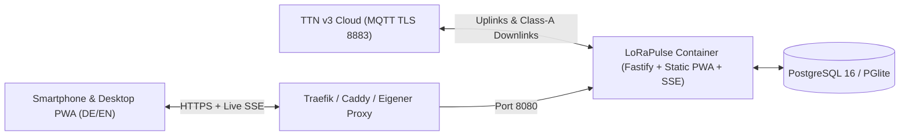

# LoRaPulse (`v0.0.1`)

**Self-Hosted Multi-Sensor LoRaWAN Progressive Web App (PWA)**  
Lizenz: **MIT** · Sprachen: **Deutsch (`de`) & Englisch (`en`)** · Deployment: **Docker Compose (Traefik / Caddy / Universal)**

---

## Überblick

**LoRaPulse** bündelt beliebige LoRaWAN-Sensoren aus einer oder mehreren **The Things Network (TTN v3)** Applications über gesicherte MQTT-Verbindungen in einer schnellen, auf dem eigenen Server gehosteten Progressive Web App:

- **Multi-TTN-Application MQTT Engine:** Beliebig viele TTN-Applications parallel anbinden (API-Keys mit **AES-256-GCM** verschlüsselt gespeichert und in API/UI maskiert), inklusive Auto-Discovery neuer Sensoren und binärem Fallback-Decoder für **Dragino `DS03A-LB`** & **`D20-LB`**.
- **Feingranulares Berechtigungssystem (`RBAC` + `Zero-Sibling-Leak`):**
  - Systemrollen: `SUPER_ADMIN`, `ADMIN`, `USER`.
  - Optionale hierarchische Kategorien, optionale Benutzergruppen sowie direkte **Einzel-Sensor-Freigaben** (`VIEWER`, `OPERATOR`, `CATEGORY_ADMIN`) ohne Preisgabe benachbarter Sensoren oder fremder Kategorienamen.
- **OpenStreetMap & OpenTopoMap Kartenansicht:** Zeigt jedem Nutzer automatisch alle für ihn sichtbaren Sensoren mit GPS-Standort (inkl. Standort-Übernahme per Smartphone-GPS oder Klick auf die Karte).
- **Visueller JSON-Feld-Mapper:** Neue LoRaWAN-Sensortypen direkt aus empfangenen TTN-Payloads per Klick mit Einheiten, Plausibilitätsgrenzen (z. B. Filterung von `-999`-Sondenfehlern) und Live-Kachelvorschau anlegen.
- **Class-A LoRaWAN Downlinks (exklusiv `SUPER_ADMIN`):** Sendeintervall über `.../down/replace` anpassen – inklusive Statusverfolgung (`QUEUED` -> `SENT` nach dem nächsten Sensor-Uplink im RX1/RX2-Fenster).
- **Geschlossenes Onboarding ohne Mailserver-Zwang:** Erststart geschützt über einmaligen `SETUP_TOKEN`; neue Konten ausschließlich durch Admins über kryptografische Einmal-Einladungslinks (`Argon2id` Passwort-Hashing).



---

## 1. Lokaler Schnellstart (Entwicklung & Live-Demo ohne Docker)

Voraussetzung: **Node.js >= 20**

```bash
# Abhängigkeiten installieren & kompletten Stack bauen
npm install
npm run build

# Direkt mit integriertem TTN-v3-MQTT-Simulator & Beispiel-Sensoren starten:
npm run dev:demo
```

Danach im Browser `http://localhost:8080` öffnen (die lokalen Demo-Zugangsdaten werden beim Start im Terminal ausgegeben).

Für einen leeren, produktionsnahen lokalen Start (mit einmaligem `SETUP_TOKEN` im Terminal):

```bash
npm start
```

Automatisierte Ende-zu-Ende-Integrations- & RBAC-Sicherheitstests ausführen:

```bash
npm test
```

---

## 2. Produktives Server-Deployment per Docker Compose

1. `.env.example` nach `.env` kopieren und eigene Zufallswerte für `POSTGRES_PASSWORD`, `ENCRYPTION_MASTER_KEY` (`openssl rand -hex 32`) und `SESSION_SECRET` eintragen:
   ```bash
   cp .env.example .env
   ```
2. Gewünschten Reverse-Proxy-Modus in `.env` über `COMPOSE_FILE` wählen:
   - **Hinter vorhandenem Traefik:**
     `COMPOSE_FILE=docker-compose.yml:docker-compose.traefik.yml`
   - **Standalone mit automatischem Let's-Encrypt-HTTPS (Caddy):**
     `COMPOSE_FILE=docker-compose.yml:docker-compose.caddy.yml`
   - **Lokales Port-Binding (`127.0.0.1:8080`) für Nginx Proxy Manager / Cloudflare Tunnel:**
     `COMPOSE_FILE=docker-compose.yml`
3. Starten & einmaligen `SETUP_TOKEN` für das erste `SUPER_ADMIN`-Konto auslesen:
   ```bash
   docker compose up -d --build
   docker compose logs lorapulse
   ```

---

## Dokumentation

- Technische Architektur & API-Referenz: [docs/TECHNICAL_DOCS.md](docs/TECHNICAL_DOCS.md)
- Benutzer- & Admin-Handbuch: [docs/USER_GUIDE.md](docs/USER_GUIDE.md)
- Architekturentscheidungen (ADRs): [docs/adr/DECISIONS.md](docs/adr/DECISIONS.md)
- UI-Sonderfälle & Sicherheitsregeln: [docs/UI_EDGE_CASES.md](docs/UI_EDGE_CASES.md)
- Aktueller Projekt-Checkpoint: [docs/CHECKPOINT.md](docs/CHECKPOINT.md)

## Lizenz

Veröffentlicht unter der [MIT License](LICENSE).
