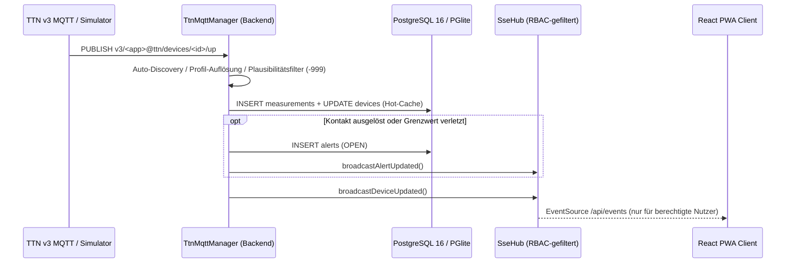

# Technische Dokumentation – LoRaPulse (`v0.0.1`)

---

## 1. Architektur-Überblick

LoRaPulse ist als modulares TypeScript-Monorepo aufgebaut:
- `packages/shared`: Gemeinsame Typen, Zod-Validierungsschemas, Li-SOCl₂-Batteriebewertung, binäre Dragino-Fallback-Decoder (`DS03A-LB`, `D20-LB`) und TDC-Downlink-Encoder (`FPort 2`).
- `backend`: Fastify-Server, Dual-Driver PostgreSQL-Schicht (`pg.Pool` für PostgreSQL 16 im Docker-Betrieb sowie `@electric-sql/pglite` für lokalen/Test-Betrieb ohne Docker), `Argon2id`-Auth, `AES-256-GCM`-Schlüsselspeicher, `TtnMqttManager` und berechtigungsgefilterter SSE-Live-Hub.
- `frontend`: React 19 + Vite PWA + Tailwind CSS v4 + `lucide-react` (strikte Zero-Emoji-UI) + Leaflet (`OpenStreetMap` / `OpenTopoMap`) + vollständige `DE`/`EN`-Lokalisierung.
- `simulator`: Eigenständiger TTN-v3-kompatibler MQTT-Broker (`aedes`) inkl. realistischer Sensor-Uplink-Generatoren und Class-A-Downlink-Warteschlangen-Simulation.

---

## 2. Datenbank-Tabellen

Alle Tabellen werden beim Serverstart idempotent initialisiert (`backend/src/db/schema.ts`):
- `users`, `sessions` (SHA-256-Token-Hashes), `invite_tokens` (einmalig einlösbar, ablaufend)
- `user_groups`, `user_group_members`
- `categories` (hierarchisch über `parent_id` und materialisierten Pfad `path`)
- `permissions` (`user_id XOR group_id` auf `category_id XOR device_id` mit Stufe `VIEWER | OPERATOR | CATEGORY_ADMIN`)
- `ttn_applications` (`api_key_encrypted` mit AES-256-GCM, `masked_api_key`)
- `sensor_profiles` (mitgelieferte Profile + eigene JSON-Mapper-Profile)
- `devices` (inkl. `latest_values_json` Hot-Cache, `probe_error_fields_json`, `pending_downlink_json`, optionale `category_id` & GPS-Felder)
- `measurements` (indiziert nach `(device_id, received_at DESC)`)
- `alerts` & `audit_logs`

---

## 3. Sicherheitsmechanismen

1. **Onboarding-Schutz:** `POST /api/auth/setup` erfordert den einmaligen `SETUP_TOKEN` und sperrt sich dauerhaft (`403`), sobald das erste Konto existiert.
2. **Passwörter & Sitzungen:** Passwörter werden mit **Argon2id** (`@node-rs/argon2`) gehasht; Sitzungen nutzen `HttpOnly`, `SameSite=Strict` Cookies (`lp_session`). Beim Sperren eines Kontos (`isActive: false`) werden aktive Sessions und offene SSE-Verbindungen sofort getrennt.
3. **Zero-Sibling-Leak:** Hat ein Benutzer auf einen Sensor ausschließlich ein direktes Einzel-Sensor-Recht (`device_id`), blendet `backend/src/services/permissions.ts` `categoryId` und `categoryBreadcrumb` serverseitig aus (`isDirectShareOnly: true`), sodass keine fremden Kategorienamen oder Nachbar-Sensoren sichtbar werden.
4. **Exklusive `SUPER_ADMIN`-Schranken:** Verwaltung von TTN-Applications (`/api/super/ttn-apps`), LoRaWAN-Downlinks (`POST /api/devices/:id/downlink`), Audit-Logs und System-Aktionen (`POST /api/super/system/action` mit erneuter Passwortprüfung) sind strikt für `SUPER_ADMIN` reserviert.

---

## 4. REST- & SSE-Schnittstellen (`v0.0.1`)

- `GET /api/health` – Liveness-/Versionsprüfung (`0.0.1`)
- `GET /api/auth/status`, `POST /api/auth/setup`, `POST /api/auth/login`, `POST /api/auth/logout`
- `GET /api/auth/invite/:token`, `POST /api/auth/invite/redeem`, `PATCH /api/auth/preferences`
- `GET /api/devices`, `PATCH /api/devices/:id`, `GET /api/devices/:id/measurements`, `GET /api/devices/:id/export` (`csv` / `json`)
- `POST /api/devices/:id/downlink` (`SUPER_ADMIN` – sendet `down/replace` auf `FPort 2`)
- `GET /api/alerts`, `POST /api/alerts/:id/ack` (`OPERATOR`+)
- `GET /api/categories`, `POST /api/categories`, `DELETE /api/categories/:id`
- `GET /api/profiles`, `POST /api/profiles`
- `GET /api/admin/users`, `POST /api/admin/users/invite`, `PATCH /api/admin/users/:id`
- `GET /api/admin/groups`, `POST /api/admin/groups`, `DELETE /api/admin/groups/:id`
- `GET /api/admin/permissions`, `POST /api/admin/permissions`, `DELETE /api/admin/permissions/:id`
- `GET /api/super/ttn-apps`, `POST /api/super/ttn-apps`, `POST /api/super/ttn-apps/:id/reconnect`, `DELETE /api/super/ttn-apps/:id`
- `GET /api/super/audit-logs`, `POST /api/super/system/action`
- `GET /api/events` – Echtzeit-SSE-Stream (`X-Accel-Buffering: no`)

---

## 5. Container-Härtung & Reverse-Proxy-Betrieb

- `docker-compose.yml`: Startet PostgreSQL 16 in einem rein internen Docker-Netzwerk (`internal: true`, kein Host-Port) und `lorapulse` als `USER 1000:1000` mit `read_only: true`, `cap_drop: [ALL]` und `no-new-privileges: true`.
- `docker-compose.traefik.yml`: Entfernt das lokale Port-Binding und bindet `lorapulse` per Labels in ein bestehendes Traefik-Netzwerk ein.
- `docker-compose.caddy.yml`: Ergänzt Caddy für vollautomatisches Standalone-HTTPS.
- `deploy/host-reboot-agent/`: Optionale `systemd`-Socket-Vorlage, falls Stufe 3 (Host-Reboot) auf dem Linux-Host freigeschaltet werden soll.
